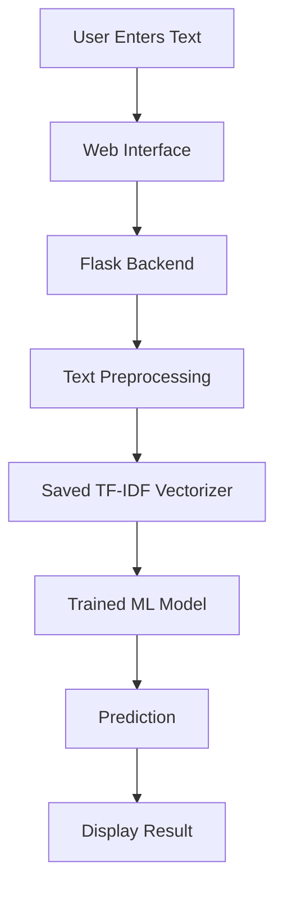

# 🧠 Sentiment Analysis for Detecting Sarcasm Using NLP & ML

<div align="center">

<!-- Replace with your actual animated GIF or project demo -->


### ✨ Decoding the Hidden Meaning Behind Words ✨

**An NLP and Machine Learning project that classifies text as sarcastic or non-sarcastic.**

<br/>


<br/>

[🚀 Features](#-key-features) •
[⚙️ Installation](#-installation-and-setup) •
[🧪 Usage](#-how-to-use) •
[📊 Results](#-model-evaluation) •
[🤝 Contributing](#-contributing)

</div>

---

## 📌 Table of Contents

- [About the Project](#-about-the-project)
- [Problem Statement](#-problem-statement)
- [Objectives](#-objectives)
- [Key Features](#-key-features)
- [Technology Stack](#-technology-stack)
- [Project Architecture](#-project-architecture)
- [Machine Learning Workflow](#-machine-learning-workflow)
- [Dataset](#-dataset)
- [Installation and Setup](#-installation-and-setup)
- [How to Use](#-how-to-use)
- [Model Evaluation](#-model-evaluation)
- [Project Structure](#-project-structure)
- [Applications](#-real-world-applications)
- [Limitations](#-limitations)
- [Future Enhancements](#-future-enhancements)
- [Contributing](#-contributing)
- [Team](#-project-team)
- [Acknowledgements](#-acknowledgements)
- [References](#-references)

---

## 🌟 About the Project

**Sentiment Analysis for Detecting Sarcasm Using NLP & ML** is a machine learning project developed to identify sarcasm in textual data.

Sarcasm is a form of expression in which the intended meaning may differ from the literal meaning of the words. Traditional sentiment analysis systems can struggle with sarcastic statements because they often rely on word patterns without fully understanding context.

For example:

> "Great! My phone battery died again."

The word *Great* is positive, but the complete sentence expresses frustration.

Our project uses Natural Language Processing (NLP) techniques and machine learning algorithms to classify text into two categories:

- 😏 **Sarcastic**
- 💬 **Non-Sarcastic**

The project combines text preprocessing, TF-IDF feature extraction, machine learning classification, and performance evaluation to create a practical sarcasm detection system.

### 🎯 Project Goal

Build a functional web application where users can enter a sentence or headline and receive a prediction from a trained machine learning model.

---

## ❗ Problem Statement

Sarcasm detection is challenging because sarcastic statements frequently contain contradictory expressions, irony, and hidden meanings.

Traditional sentiment analysis systems may misclassify such text by focusing on individual words instead of the overall expression.

This project aims to develop an NLP and ML-based system that learns patterns from labelled text data and predicts whether a given sentence is sarcastic or non-sarcastic.

---

## 🎯 Objectives

- Develop an automated sarcasm detection system.
- Apply NLP techniques to clean and normalize textual data.
- Convert text into numerical representations using TF-IDF.
- Train and evaluate machine learning classification algorithms.
- Compare model performance using standard evaluation metrics.
- Provide a simple interface for entering text and viewing predictions.
- Visualize dataset distribution and model performance.

---

## 🚀 Key Features

| Feature | Description |
|---|---|
| 📝 Text Analysis | Accepts user-entered text or headlines. |
| 🧹 Text Preprocessing | Cleans text and prepares it for classification. |
| 🔢 TF-IDF Vectorization | Converts text into numerical features. |
| 🤖 ML Classification | Uses a trained model to predict sarcasm. |
| 📊 Performance Dashboard | Displays available model evaluation metrics. |
| 📈 Data Visualization | Shows class distribution and performance charts. |
| ⚡ Real-Time Prediction | Returns a prediction through the web interface. |
| 📱 Responsive Interface | Designed to work on desktop and mobile screens. |
| 💾 Model Persistence | Saves the trained model for reuse. |

> Note: Features such as the web interface, live dashboard, and real-time prediction require the corresponding application components to be implemented and connected.

---

## 🛠️ Technology Stack

<div align="center">

| Technology | Purpose |
|---|---|
| Python | Core programming language |
| Pandas | Dataset loading and manipulation |
| NumPy | Numerical operations |
| NLTK | Natural Language Processing |
| Scikit-learn | Feature extraction, training, and evaluation |
| TF-IDF | Text feature representation |
| Logistic Regression | Primary classification model |
| Linear SVC | Alternative classification model |
| Random Forest | Alternative classification model |
| Multinomial Naive Bayes | Alternative classification model |
| Matplotlib | Data visualization |
| Flask | Web application backend, if implemented |
| HTML, CSS, JavaScript | Web interface, if implemented |
| Pickle | Saving and loading trained model artifacts |

</div>

---

## 🏗️ Project Architecture



The diagram describes the intended web application architecture. Flask and the browser interface must be implemented and connected to the trained model for this workflow to operate end to end.

---

## 🔄 Machine Learning Workflow

<div align="center">

```text
        📂 Dataset
            ↓
       🧹 Data Cleaning
            ↓
      🔤 Text Preprocessing
            ↓
     🔢 TF-IDF Vectorization
            ↓
      ✂️ Train-Test Split
            ↓
       🤖 Model Training
            ↓
       📊 Model Evaluation
            ↓
       💾 Save Best Model
            ↓
       🔍 Text Prediction
```

</div>

### 1. Dataset Preparation

Load the labelled headline dataset and inspect its columns, missing values, and duplicate records.

### 2. Text Preprocessing

Prepare text using techniques such as:

- Lowercase conversion
- Tokenization
- Punctuation removal
- Stopword removal, where appropriate
- Lemmatization or stemming, where used by the training pipeline

Preprocessing must be consistent between model training and prediction.

### 3. Feature Extraction

Use TF-IDF (Term Frequency–Inverse Document Frequency) to transform text into numerical features that machine learning algorithms can process.

### 4. Model Training

Train the selected classification algorithms using labelled examples.

### 5. Evaluation

Measure performance using accuracy, precision, recall, F1-score, and a confusion matrix.

### 6. Prediction

Transform new text using the fitted vectorizer and pass the resulting features to the trained classifier.

---

## 📂 Dataset

The project uses a cleaned news headline dataset.

### Dataset Details

| Attribute | Description |
|---|---|
| Dataset file | `cleaned_data.csv` |
| Text column | `headline` |
| Label column | `label` |
| Sarcastic class | `sarcastic` |
| Non-sarcastic class | `non-sarcastic` |
| Approximate original row count | 26,524 |

The row count may change after removing missing values or duplicates.

### Sample Dataset

| headline | label |
|---|---|
| Amazing! Another exam tomorrow | sarcastic |
| Government announces new education policy | non-sarcastic |

These rows are illustrative examples of the expected schema, not verified records from the CSV.

### Dataset Source

The original project presentation references the News Headlines Dataset for Sarcasm Detection on Kaggle.

Dataset: [News Headlines Dataset for Sarcasm Detection](https://www.kaggle.com/datasets/rmisra/news-headlines-dataset-for-sarcasm-detection)

---

## 💻 Installation and Setup

### Prerequisites

Install the following:

- Python 3.9 or later
- Git (optional)
- Visual Studio Code or another Python editor
- Google Colab or a local Python environment

### Step 1: Clone the Repository

Replace the URL below with your actual GitHub repository URL.

```bash
git clone https://github.com/YOUR_USERNAME/YOUR_REPOSITORY.git
```

Navigate to the project folder:

```bash
cd YOUR_REPOSITORY
```

### Step 2: Create a Virtual Environment

**Windows:**

```bash
python -m venv venv
venv\Scripts\activate
```

**macOS/Linux:**

```bash
python3 -m venv venv
source venv/bin/activate
```

### Step 3: Install Dependencies

If `requirements.txt` exists:

```bash
pip install -r requirements.txt
```

Otherwise, install the core libraries:

```bash
pip install pandas numpy matplotlib scikit-learn nltk flask
```

### Step 4: Download NLTK Resources

Run Python and execute:

```python
import nltk

nltk.download("stopwords")
nltk.download("wordnet")
nltk.download("omw-1.4")
```

Download only the NLTK resources actually required by your preprocessing code.

### Step 5: Verify the Dataset

Ensure `cleaned_data.csv` is in the expected project directory.

```python
import pandas as pd

df = pd.read_csv("cleaned_data.csv")

print(df.head())
print(df.shape)
print(df.columns.tolist())
print(df.isnull().sum())
```

Expected columns:

```text
headline
label
```

### Step 6: Train the Model

If the trained model files do not exist, run the training script provided by the project:

```bash
python train_model.py
```

The script should train the model, evaluate it, and save the model artifacts.

If your project uses different script or artifact names, follow the actual project files.

### Step 7: Run the Web Application

If the Flask application is implemented:

```bash
python app.py
```

Open the local URL shown in the terminal, commonly:

```text
http://127.0.0.1:5000
```

If the project currently contains only a notebook, complete the Flask integration before using these web application steps.

---

## 🧪 How to Use

Once the web application is running:

1. Open the application in your browser.
2. Navigate to the sarcasm detector.
3. Enter a sentence or headline.
4. Click **Analyze Text**.
5. Review the model's prediction.
6. Try additional examples to compare the results.

### Example Inputs

**Example 1**

```text
Perfect! I forgot my homework again.
```

Expected human interpretation: sarcastic.

**Example 2**

```text
Government announces new education policy.
```

Expected human interpretation: generally non-sarcastic.

The model may predict either label incorrectly. These examples demonstrate intended use, not guaranteed outputs.

---

## 📊 Model Evaluation

The project evaluates classification performance using standard metrics.

| Metric | Meaning |
|---|---|
| Accuracy | Proportion of all predictions that are correct. |
| Precision | Proportion of predicted sarcastic examples that are actually sarcastic. |
| Recall | Proportion of actual sarcastic examples detected by the model. |
| F1-score | Harmonic mean of precision and recall. |
| Confusion Matrix | Displays correct and incorrect predictions by class. |

### Previously Reported Results

The project report describes an earlier evaluation with approximately **79% overall accuracy**.

The reported class-level results included:

| Class | Precision | Recall | F1-score |
|---|---:|---:|---:|
| Non-sarcastic | 0.79 | 0.87 | 0.83 |
| Sarcastic | 0.81 | 0.69 | 0.74 |

These values are historical results from the report and may differ from a newly trained model. Recalculate the metrics on the current test split before presenting them as the performance of your deployed application.

### Suggested Visualizations

- Class distribution chart
- Confusion matrix
- Model comparison chart
- TF-IDF feature size versus accuracy
- Precision, recall, and F1-score comparison

Only publish charts generated from actual evaluation results.

---

## 📁 Project Structure

A possible structure for the complete project is:

```text
sarcasm-detection/
│
├── app.py
├── train_model.py
├── cleaned_data.csv
├── requirements.txt
├── README.md
│
├── models/
│   ├── sarcasm_model.pkl
│   └── vectorizer.pkl
│
├── artifacts/
│   ├── evaluation_metrics.json
│   └── confusion_matrix.png
│
├── templates/
│   ├── base.html
│   ├── index.html
│   ├── detector.html
│   ├── dashboard.html
│   ├── about.html
│   └── team.html
│
├── static/
│   ├── css/
│   │   └── style.css
│   ├── js/
│   │   └── app.js
│   └── images/
│       └── sarcasm-banner.gif
│
└── tests/
    └── test_app.py
```

This is a suggested structure. Keep only files that exist or are implemented in your actual repository.

---

## 🎬 Adding Animations to This README

GitHub README files support animated GIFs and some HTML elements. They do not run arbitrary JavaScript or CSS animations inside the README itself.

To make this README visually engaging, add actual GIF files to your repository.

### Suggested Animated Assets

| File | Animation idea |
|---|---|
| `assets/sarcasm-banner.gif` | Animated project title and NLP-themed background |
| `assets/workflow.gif` | Dataset-to-prediction workflow |
| `assets/model-training.gif` | Text processing and model training animation |
| `assets/web-demo.gif` | Screen recording of the working website |
| `assets/prediction-demo.gif` | Entering text and displaying a real prediction |

After adding a GIF, embed it like this:

```html
<div align="center">
  
</div>
```

For a hosted GIF, use its actual publicly accessible URL.

### Animated Typing Heading

You can also use a typing animation service:

```html
<div align="center">
  <img
    src="https://readme-typing-svg.demolab.com?font=F
